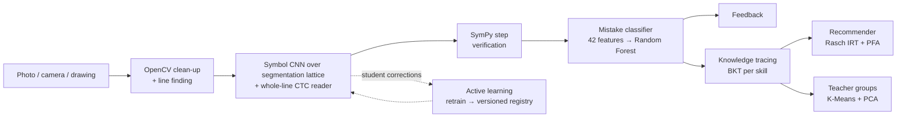

# StepWise — Explainable ML Tutor for Handwritten Math

*AI-Powered Multimodal Personal Tutor (research project)*

A student uploads, photographs or draws their handwritten arithmetic or linear-equation working.
StepWise then:

1. **reads it** with two small neural readers trained on real handwriting: a symbol CNN over a lattice of
   possible segmentations, and a whole-line CTC reader for touching symbols;
2. **proves which step is wrong** with SymPy (never `eval`);
3. **names the misconception** with a Random Forest over 42 explainable features, and shows
   the evidence behind the diagnosis;
4. lets the student **fix misread symbols**. The fixes become training data (active learning).
5. **tracks mastery per skill** with Bayesian Knowledge Tracing and **recommends practice** with
   IRT so each question has about a 70% predicted chance of success;
6. **groups the class by misconception** for the teacher (K-Means on student profiles).

Diagnosis, tracing, recommendation and grouping are **classical ML** (scikit-learn, numpy, scipy).
The two readers are small CNNs trained with PyTorch and exported to ONNX. At runtime they run in
OpenCV's DNN module, so the app needs no PyTorch, no GPU and no API keys. Everything runs offline on
a laptop CPU, and the models total about 31 MB.
See **[docs/ML_APPROACH.md](docs/ML_APPROACH.md)** for methods, model comparisons, results and
limitations.



## Headline results (seed 0, from `backend/ml_models/reports/`)

| Model | Data | Best algorithm | Result | Compared against |
|---|---|---|---|---|
| Recognizer, CROHME 2014/16/19 test (127 expressions, unseen writers) | **real**: CROHME, HME100K, MathWriting, HASYv2, MNIST (+ fonts) | Symbol CNN + line CTC reader | **69.3%** of whole expressions exact; **94.2%** symbol accuracy | Review-3 HOG + SVM: 61.4% (92.6% symbols) |
| Recognizer, HME100K test (590 **real phone photos**) | same | same | **35.6%** exact | HOG + SVM 4.6%; CNN alone 14.1% |
| Recognizer, MathWriting test (34, unseen writers) | same | same | **61.8%** exact | HOG + SVM 41.2% |
| Knowledge tracing | **real**: ASSISTments 2009 (446k answers) | PFA + IRT + recency | next-answer AUC **0.815** | EMA 0.811, PFA 0.787, BKT 0.771 |
| Mistake classifier | synthetic | Random Forest | macro-F1 0.992 (upper bound) | **old rules 0.311**, GB 0.991, LR 0.987 |
| Mistake classifier | **real**: CogTutorBugs (95 students, typed) | Random Forest, synthetic + real errors | finds **100%** of real wrong steps, accepts 99.3% of valid ones; names the category for **76.6%** (95% CI 74.5–78.7, macro-F1 0.70) of 1,552 real errors on held-out problem templates | synthetic-only 52.1%, majority class 53.2%, old rules 2% |
| Error type | **real**: ScratchMath (1,720 photographed student errors) | Random Forest | slip vs. misunderstanding **70.4%**; 7 expert error types 48.8% | majority 55.2% / 32.9% |
| Practice policy | simulated learners | Adaptive (BKT + IRT) | 74% of skills mastered in 40 items | random 64% |
| Class grouping | simulated class | K-Means | ARI 0.82 vs planted groups | Agglomerative (Ward) |

Exact-expression accuracy needs every symbol of a line right (lines average 9–14 symbols). The
target of 90% exact expressions is **not** reached. Most remaining errors on real photos are touching
or crowded digits and faint ink, which is why confirm-before-diagnose stays on (see below). The
synthetic mistake-classifier score is an upper bound; see `docs/ML_APPROACH.md` for every caveat.

## Real datasets used

All are public. `make datasets` downloads them (about 8 GB, into the git-ignored
`backend/data/external/`); nothing is redistributed with the repo.

| Dataset | What it is | Used for | Licence |
|---|---|---|---|
| **CROHME** train + 2014/2016/2019 test (Mouchère et al.) | real handwritten expressions | recognizer training; **test** (127 in-scope expressions, unseen writers) | research use (HF `Neeze/CROHME-full`) |
| **HME100K** (Yuan et al., CVPR 2022) | 99k **phone photos** of students' handwritten math on paper | recognizer training (25,960 lines); **real-photo test** (590) | research use (HF mirror `ConstantHao/HME100K`; official ai.100tal.com) |
| **MathWriting 2024** (Gervais et al., Google) | 230k expressions from thousands of writers | recognizer training (10,851 lines); **diverse-writer test** (writer-disjoint) | CC BY-NC-SA 4.0 |
| **HASYv2** (Thoma, 2017) | handwritten symbols, 144 writers | symbol training | ODbL |
| **MNIST** | handwritten digits on paper | symbol training (train split); **writers study** (test split: high-school students vs Census staff) | CC BY-SA 3.0 |
| **CogTutorBugs** (McNichols, Zhang & Lan, 2023) | 5,339 real erroneous algebra steps, 95 students | misconception **validation**; 30% of problem templates added to training | CC BY 4.0 |
| **ScratchMath** (HF `songdj/ScratchMath`) | 1,720 photos of real student scratchwork with expert error labels | error-type classifier (slip vs misunderstanding) | CC BY-NC-SA 4.0 |
| **ASSISTments 2009–2010** (Feng, Heffernan & Koedinger) | 446,844 answers, 4,151 students, 110 skills | knowledge-tracing benchmark; BKT parameters for skills S1–S7; skill mapping | research use |

## Validation studies (Review-3)

`cd backend && python -m app.ml.validate` (about 30 min) runs the deployed models through the
studies below and writes `ml_models/reports/validation_*.json`.

| Study | Question | Finding |
|---|---|---|
| `reading` | How well are whole lines read? | 94.2% of CROHME test symbols, 70% of lines exact. Touching symbols are the largest error source; the segmentation lattice and the line reader target them. |
| `propagation` | What do misreads cost the diagnosis? | On 420 solutions composed from real test-writer glyphs, accuracy drops from 99% (true text) to 29%. Confirm-before-diagnose brings it back to **92.4%**, with about 8 of 14 symbols to check per page. |
| `capture` | Phone photos? | Simulated paper, rules, lighting, shadow, tilt, blur, noise and resolution. Page binarization cuts the character error rate on ruled paper from 0.84 to 0.19, under uneven lighting from 0.70 to 0.16 and under a cast shadow from 0.77 to 0.18. Real photos: HME100K test above. |
| `writers` | Other writers? | MNIST paper digits: **98.8%** (high-school students) and **99.3%** (Census staff), up from 86% and 85% with the SVM. |
| `cogtutor` | Real student errors? | All real wrong steps found, 99.3% of valid steps accepted. Category accuracy on held-out templates: 46% (v1), 52% (new features), **76.6%** after adding the real errors of a separate 30% of templates to training. |
| `skills` | ASSISTments to StepWise skills? | Mapping with match quality, data volume, deployed BKT parameters and per-skill AUC. |
| `policy` | Is the adaptive advantage a simulator artefact? | Holds under real-calibrated (post-test d = 0.50) and heterogeneous (d = 0.29) learners. Shrinks when learners forget (d = 0.17) and vanishes when all are combined (d = 0.04). Only a classroom study can settle it. |

What still needs real people (photographed student work, a classroom trial) is specified in
[docs/REAL_WORLD_VALIDATION.md](docs/REAL_WORLD_VALIDATION.md). Evaluate a collected set with
`python evaluation/real_world_eval.py --manifest ...`.

## App tour

| Area | Page | What it shows |
|---|---|---|
| Student | **New work** | Upload / camera / draw-on-screen input; answer key optional |
| | **Analysis** | Image with colour-coded symbol boxes (click to correct); step-by-step ✓/✗; ML diagnosis with probability and evidence; feedback, hint, worked solution; per-stage timings |
| | **Practice** | 3 recommended items for the diagnosed or weakest skill; live BKT mastery |
| | **My progress** | Mastery per skill, mastery-over-time chart, mistake patterns, history |
| Teacher | **Class overview** | Named misconception groups with activity suggestions; PCA map; mastery heatmap |
| ML Lab | **Models** | Model cards; algorithm comparisons; confusion matrices; feature importances; BKT/IRT diagnostics; policy simulation |
| | **Symbol model** | Version history and **Retrain with corrections** → compare → activate |
| | **Playground** | Draw symbols and see the symbol CNN's top-5 probabilities and the glyph it sees |
| | **Training data** | Augmented glyph samples, fonts, corrections collected |
| | **OCR benchmark** | `ml` vs optional TrOCR / Donut / vision-API on a manifest |

## Setup

Prerequisites: Python 3.10+ and Node 20+.

```bash
# backend
cd backend
python -m venv .venv && source .venv/bin/activate
pip install -r requirements.txt
python scripts/download_datasets.py hasy crohme hme100k mathwriting mnist assistments cogtutor scratchmath  # optional
python -m app.ml.train                    # optional: trained models already ship in ml_models/
python scripts/seed_demo_data.py          # demo student with 4 analysed images
python scripts/seed_demo_class.py         # 24 simulated students for the teacher view (~30 s)
uvicorn app.main:app --reload --port 8000

# frontend (second terminal)
cd frontend
npm install
npm run dev                               # http://localhost:5173
```

Or use `make backend-install`, `make seed-demo`, `make backend-run`, `make frontend-install` and
`make frontend-run`. To retrain everything, run `make ml-train`.
To run in Docker: `docker compose up --build` (frontend on http://localhost:8080).

Optional deep-learning baselines for the benchmark:
`pip install -r requirements-dl.txt` (TrOCR/Donut), or set `VISION_API_BACKEND` in `.env`.

## Tests

```bash
cd backend && python -m pytest tests -q     # 209 tests
cd frontend && npm run build
```

The tests cover:

- every mistake feature and every item-bank answer, verified with SymPy;
- BKT parameter recovery and Rasch difficulty recovery;
- the recommender and clustering;
- the practice, teacher, ML Lab, symbol-correction and retraining flows;
- the registry;
- a tiny end-to-end training run.

## Repository layout

```
backend/app/
  ml/                symbol + mistake models, tracing/ (BKT, PFA, simulator), irt/ (item bank, Rasch,
                     recommender), clustering/, registry, active_learning, model_cards, train.py
  services/          pipeline orchestration, SymPy parser, diagnosis, feedback, learner service
  api/               submissions, practice, teacher, lab, progress, quizzes, benchmark
  providers/         ml (default), demo, trocr/donut/vision_api (optional baselines)
backend/ml_models/   shipped models + reports/*.json read by the ML Lab
backend/scripts/     demo image generation, demo student, simulated class
frontend/src/        React app: pages/, components/ (ui, capture), api/
docs/                ML_APPROACH.md (start here), ARCHITECTURE.md, DATASET_GUIDE.md
evaluation/          benchmark CLI + manifests
```

## Limitations

- **Reading is not yet 90% exact.** 69% of CROHME expressions and 36% of real phone photos are read
  exactly. Longer lines and touching digits fail most.
- **Real misconception data is typed.** The classifier now learns from real CogTutor errors and names
  76.6% of held-out real errors correctly, but real *handwritten* work labelled with our categories is
  still to be collected (docs/REAL_WORLD_VALIDATION.md).
- **Reading limits diagnosis.** Uncertain symbols must be confirmed before a diagnosis is given,
  which costs the student several taps per page.
- **Real photos come from HME100K**, not from StepWise users. Photos taken with the app in a classroom
  (Study A) and a classroom trial of adaptive practice (Study B) still need participants.
- **Scope.** Arithmetic (+ − × ÷, negatives, brackets) and single-variable linear equations. No
  vertical fractions, exponents or word problems.
