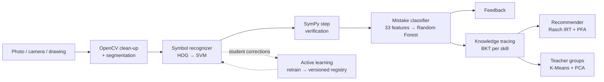

# StepWise — Explainable ML Tutor for Handwritten Math

*AI-Powered Multimodal Personal Tutor (research project)*

A student uploads, photographs or draws their handwritten arithmetic or linear-equation working.
StepWise then:

1. **reads it** with a classical-ML symbol recognizer (OpenCV segmentation, then HOG features, then an SVM);
2. **proves which step is wrong** with SymPy (never `eval`);
3. **names the misconception** with a Random Forest over 33 explainable features, and shows
   the evidence behind the diagnosis;
4. lets the student **fix misread symbols**. The fixes become training data (active learning).
5. **tracks mastery per skill** with Bayesian Knowledge Tracing and **recommends practice** with
   IRT so each question has about a 70% predicted chance of success;
6. **groups the class by misconception** for the teacher (K-Means on student profiles).

Every learned component is **classical ML** (scikit-learn, numpy, scipy). It runs offline on a
laptop CPU, the models total about 6 MB, and there are no neural networks and no API keys.
See **[docs/ML_APPROACH.md](docs/ML_APPROACH.md)** for methods, model comparisons, results and
limitations.



## Headline results (seed 0, from `backend/ml_models/reports/`)

| Model | Data | Best algorithm | Result | Compared against |
|---|---|---|---|---|
| Symbol recognizer | **real**: CROHME + HASYv2 (+ fonts) | SVM (RBF) | **92.6%** symbol accuracy (macro-F1 0.90) on CROHME 2014/16/19 test (unseen writers); 57% of whole expressions exact | fonts-only training: 55%; RF 0.88, LR 0.88, kNN 0.85 |
| Symbol reader vs deep learning | **real**: 127 CROHME test expressions | HOG + SVM vs TrOCR-base | **56.7% vs 28.4%** exact; 48 ms vs 1,325 ms; 8 MB vs 1.3 GB | McNemar p = 1.3×10⁻⁷ |
| Knowledge tracing | **real**: ASSISTments 2009 (446k answers) | PFA + IRT + recency | next-answer AUC **0.815** | EMA 0.811, PFA 0.787, BKT 0.771 |
| Mistake classifier (9 fine-grained types) | synthetic | Random Forest | macro-F1 0.994 (upper bound) | **old rules 0.330**, GB 0.991, LR 0.992 |
| Error type: slip vs understanding gap | **real**: ScratchMath (1,720 real student mistakes + scratchwork photos) | Logistic Regression | **68.3%** accuracy, AUC 0.76 | majority 55.2%; 7-type RF 49.1% vs majority 32.9% |
| Practice policy | simulated learners | Adaptive (BKT + IRT) | 74% of skills mastered in 40 items | random 64% |
| Class grouping | simulated class | K-Means | ARI 0.82 vs planted groups | Agglomerative (Ward) |

Real datasets are downloaded by `make datasets` (about 1.1 GB) and never committed. See
`docs/ML_APPROACH.md` for every caveat.

## App tour

| Area | Page | What it shows |
|---|---|---|
| Student | **New work** | Upload / camera / draw-on-screen input; answer key optional |
| | **Analysis** | Image with colour-coded symbol boxes (click to correct); step-by-step ✓/✗; ML diagnosis with probability and evidence; feedback, hint, worked solution; per-stage timings |
| | **Practice** | 3 recommended items for the diagnosed or weakest skill; live BKT mastery |
| | **My progress** | Mastery per skill, mastery-over-time chart, mistake patterns, history |
| Teacher | **Class overview** | Named misconception groups with activity suggestions; PCA map; mastery heatmap |
| ML Lab | **Models** | Model cards; algorithm comparisons; confusion matrices; feature importances; BKT/IRT diagnostics; policy simulation |
| | **Symbol model** | Version history and **Retrain with corrections** → compare → activate |
| | **Playground** | Draw symbols and see the SVM's top-5 probabilities and the 28×28 glyph it sees |
| | **Training data** | Augmented glyph samples, fonts, corrections collected |
| | **OCR benchmark** | `ml` vs optional TrOCR / Donut / vision-API on a manifest |

## Setup

Prerequisites: Python 3.10+ and Node 20+.

```bash
# backend
cd backend
python -m venv .venv && source .venv/bin/activate
pip install -r requirements.txt
python scripts/download_datasets.py       # optional: real datasets (CROHME, HASYv2, ASSISTments)
python -m app.ml.train                    # optional: trained models already ship in ml_models/
python scripts/seed_demo_data.py          # demo student with 4 analysed images
python scripts/seed_demo_class.py         # 24 simulated students for the teacher view (~30 s)
uvicorn app.main:app --reload --port 8000

# frontend (second terminal)
cd frontend
npm install
npm run dev                               # http://localhost:5173
```

Or use `make backend-install`, `make seed-demo`, `make backend-run`, `make frontend-install` and
`make frontend-run`. To retrain everything, run `make ml-train`.
To run in Docker: `docker compose up --build` (frontend on http://localhost:8080).

Optional deep-learning baselines for the benchmark:
`pip install -r requirements-dl.txt` (TrOCR/Donut), or set `VISION_API_BACKEND` in `.env`.

## Paper

`paper/main.tex` is a Springer (LNCS/LNEE-style) paper with figures generated from the reports.
- Build it with `cd paper && tectonic main.tex`, or upload the folder to Overleaf.
- Re-run the paper experiments (confidence intervals, ablations, robustness, TrOCR comparison) with
  `python -m app.ml.paper_experiments`.

## Tests

```bash
cd backend && python -m pytest tests -q     # 175 tests
cd frontend && npm run build
```

The tests cover:

- every mistake feature and every item-bank answer, verified with SymPy;
- BKT parameter recovery and Rasch difficulty recovery;
- the recommender and clustering;
- the practice, teacher, ML Lab, symbol-correction and retraining flows;
- the registry;
- a tiny end-to-end training run.

## Repository layout

```
backend/app/
  ml/                symbol + mistake models, tracing/ (BKT, PFA, simulator), irt/ (item bank, Rasch,
                     recommender), clustering/, registry, active_learning, model_cards, train.py
  services/          pipeline orchestration, SymPy parser, diagnosis, feedback, learner service
  api/               submissions, practice, teacher, lab, progress, quizzes, benchmark
  providers/         ml (default), demo, trocr/donut/vision_api (optional baselines)
backend/ml_models/   shipped models + reports/*.json read by the ML Lab
backend/scripts/     demo image generation, demo student, simulated class
frontend/src/        React app: pages/, components/ (ui, capture), api/
docs/                ML_APPROACH.md (start here), ARCHITECTURE.md, DATASET_GUIDE.md
evaluation/          benchmark CLI + manifests
```

## Limitations

- **The fine-grained mistake classifier is synthetic.** The real-data second opinion (ScratchMath)
  uses coarser labels and Chinese questions. An English hand-labelled classroom set would
  validate both.
- **CROHME is tablet handwriting rendered to images**, not phone photos of paper.
- **Segmentation.** It assumes symbols don't touch, so cursive or joined digits are under-segmented.
- **Scope.** Arithmetic (+ − × ÷, negatives, brackets) and single-variable linear equations. No
  vertical fractions, exponents or word problems.
